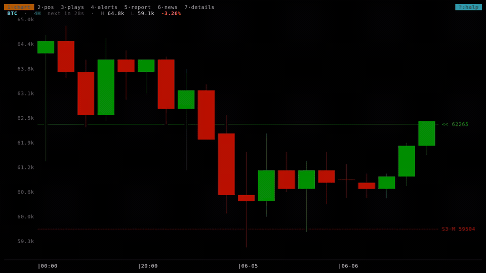

# carrac-tui

[Website](https://carrac.cc/?utm_source=github&utm_medium=readme) · [Get an API key](https://app.carrac.cc/register?utm_source=github&utm_medium=readme) · [Discord](https://discord.gg/jD4he3hq4A)

**Carrac Trader Cockpit** — a market terminal for [Carrac.cc](https://carrac.cc). Candlestick charts, open positions, trading plays, alerts, reports, news and AI workflows — all rendered as crisp Unicode in your terminal, fast enough to live in a tmux pane all day. The browser is the canvas; the terminal is the cockpit.

Not signals to follow — a tool for trading on process.



Want a taste with zero install? Pipe a chart straight into your terminal:

```bash
curl carrac.cc/btc
```

## Install

**Linux and macOS:**

```bash
curl --proto '=https' --tlsv1.2 -LsSf https://github.com/Carrac-cc/carrac-tui/releases/latest/download/carrac-tui-installer.sh | sh
```

**Windows** (PowerShell):

```powershell
irm https://github.com/Carrac-cc/carrac-tui/releases/latest/download/carrac-tui-installer.ps1 | iex
```

Both installers **auto-detect your OS and CPU** and download the right build — the recommended path on every platform, so you don't have to decode any of the names below.

<details>
<summary><b>Prefer a manual download?</b> (pick a specific build)</summary>

Grab an archive from the [latest release](https://github.com/Carrac-cc/carrac-tui/releases/latest); each holds a single `carrac` binary — drop it on your `PATH`. Not sure which? Run `uname -m`: `x86_64` is an Intel/AMD machine, `aarch64` is ARM.

| Platform | Archive |
| -------- | ------- |
| Linux x86_64 · glibc — **most Linux PCs** | `carrac-tui-x86_64-unknown-linux-gnu.tar.xz` |
| Linux x86_64 · musl — static; Alpine, or a glibc-version fallback | `carrac-tui-x86_64-unknown-linux-musl.tar.xz` |
| Linux aarch64 — ARM (Raspberry Pi, ARM servers) | `carrac-tui-aarch64-unknown-linux-gnu.tar.xz` |
| macOS — Apple Silicon (M-series) | `carrac-tui-aarch64-apple-darwin.tar.xz` |
| macOS — Intel | `carrac-tui-x86_64-apple-darwin.tar.xz` |
| Windows x86_64 | `carrac-tui-x86_64-pc-windows-msvc.zip` |

</details>

> On Windows, use a terminal with good Unicode coverage — **Windows Terminal** renders the sextant candles correctly; the legacy console host does not.

**From source** (Rust 1.88+, 2024 edition) — build it yourself with Cargo:

```bash
# one command, no clone needed:
cargo install --git https://github.com/Carrac-cc/carrac-tui

# …or clone first if you want to read or modify the code, then install the
# crate in the current directory (that's what the "." means — not a path you fill in):
git clone https://github.com/Carrac-cc/carrac-tui
cd carrac-tui
cargo install --path .
```

**Upgrading:** re-run the installer one-liner (or `cargo install` again) — it
replaces the binary in place. Your settings, API key and watchlist live under
`~/.config/carrac/` and are never touched by an upgrade.

## Quickstart

`carrac` runs **keyless out of the box**. With no API key configured it drops into a demo backed by public Binance market data — every chart works immediately:

```bash
carrac chart BTC      # interactive candlestick chart
carrac tui            # full-screen cockpit
```

Add a **Carrac API key** to unlock every surface — positions, plays, alerts, reports, news, the details matrix, the scanner and AI workflows. Register at [carrac.cc/reg](https://carrac.cc/reg) and grab your key from [app.carrac.cc](https://app.carrac.cc).

**Your watchlist syncs from your account.** The asset selector (`a`) and the `,` / `.` favourite cycle are populated by the favourites you save on the web at [carrac.cc](https://carrac.cc) — set them there and they appear in the TUI on launch (and re-poll periodically). With no key, the TUI uses a built-in starter list (`BTC`, `ETH`, `SOL`, …) and you can still chart any symbol from the asset selector.

## Configure

Settings live at `~/.config/carrac/config.toml` on Linux. On macOS the
equivalent is `~/Library/Application Support/cc.carrac.carrac/config.toml`; on
Windows, `%APPDATA%\carrac\carrac\config.toml`.

```toml
api_key  = "your-carrac-key"
base_url = "https://app.carrac.cc"   # default
backend  = "carrac"                  # "carrac" | "binance" — defaults to carrac when a key is set, else binance
```

Environment variables override the file:

| Variable           | Purpose            |
| ------------------ | ------------------ |
| `CARRAC_API_KEY`   | API key            |
| `CARRAC_BASE_URL`  | Backend base URL   |

## Surfaces

### CLI commands

| Command              | What it does                                                         |
| -------------------- | ------------------------------------------------------------------- |
| `carrac positions`   | Open positions snapshot (`--watch N` to poll, `--detail`, `--asset`) |
| `carrac plays`       | Inspect and evaluate trading plays (`list` / `show <id>` / `eval <id>`) |
| `carrac alerts`      | Alert triage (`list` / `ack <id>` / `clear <id>`)                   |
| `carrac chart <SYM>` | Interactive candlestick chart (`--tf`, `--bars`, `--indicators`, `--position`, `--png`) |
| `carrac tui`         | Full-screen cockpit (all views below)                              |

### `carrac tui` cockpit views

Switch with number keys `1`–`7` (or `Tab` / `Space` to cycle):

`chart` · `positions` · `plays` · `alerts` · `report` · `news` · `details`

Press `a` for the asset selector, `r` to force-refresh, and `?` for the full key reference.

### Bring your own AI agent

There is no built-in chatbot. Press `I` ("Intelligence") in the cockpit and `carrac` suspends itself, writes the current view's context to a workspace — for the chart view that's a rendered `chart.png` plus the underlying data as JSON — and hands your terminal to **your own agent** (Claude Code by default; configurable via `[agent] command = "..."` in config.toml, e.g. `aider` or `gemini`). Quit the agent to drop back into the cockpit.

Your agent doesn't reason over a screenshot of price levels: it gets the chart as structured data, and — once you've connected it to the [Carrac MCP server](https://carrac.cc/mcp?utm_source=github&utm_medium=readme) — live access to your positions, open plays, journal and the market structure underneath. Data, not pixels. Your agent, your tokens, your tooling.

## Chart

The default renderer uses a **sextant** raster (six sub-cells per character) so candles stay readable at any terminal size: bodies are cell-quantized rectangles with sharp edges, while wicks are drawn at sub-cell resolution for precision. On top of price it layers the CPR pivot set, an EMA ribbon (EMA30/EMA60 with per-bar trend coloring) plus EMA21, and optional volume and RSI sub-panes and a market-session strip. Everything uses ANSI named colors, so your terminal palette governs the hue. Toggle `s` for a clean close-price line instead.

> **Terminal support:** sextant glyphs come from Unicode's *Symbols for Legacy Computing* block. Terminals that synthesize block glyphs themselves — **kitty, Ghostty, WezTerm, foot** — render them pixel-perfect out of the box. On other terminals you need a font that covers that block (e.g. Iosevka, Cascadia Code); if you see hollow boxes, switch font or toggle `s` for the line style, which uses plain box-drawing characters everywhere.

Main keys in the chart view:

| Key            | Action                                              |
| -------------- | --------------------------------------------------- |
| `t` / `T`      | Cycle timeframe (`5m → 15m → 1H → 4H → 1D → 1W`)     |
| `d` / `w`      | Jump to 1D / 1W                                      |
| `h` / `l`      | Pan left / right · `H` / `L` half-window            |
| `j` / `k`      | Vertical zoom out / in · `↑` / `↓` pan the price window |
| `]` / `[`      | More / fewer candles (zoom)                         |
| `0`            | Reset pan + zoom                                     |
| `c e E p v R o` | Toggle CPR · EMA21 · EMA ribbon · position · volume · RSI · overlays |
| `z`            | Toggle market-session strip                         |
| `s`            | Toggle candle style (sextant ⇄ line)                |
| `P`            | Render a PNG chart (inline on kitty/ghostty/wezterm)|
| left-click     | Pin the crosshair to a column · right-click / `x` clears it |

## Bring your own backend

Chart data flows through a single provider seam (the `Provider` enum). Two backends ship today: the authenticated Carrac platform and a keyless public adapter for crypto OHLCV (Binance, with an automatic Kraken fallback for region-blocked clients). The seam is enum-dispatched and the renderer treats every Carrac-computed overlay as optional, so a third data source can slot in without touching the render code. The data contract is the `ChartResponse` shape in `src/chart/data.rs`; `src/chart/provider.rs` and `src/chart/kraken.rs` are the reference adapters.

## Privacy

No telemetry, no analytics, no auto-update. The only network calls `carrac`
makes are to the backend you configure — the Carrac platform, or a public
exchange in keyless demo mode. Nothing is phoned home.

## License

Dual-licensed under either of [Apache License 2.0](LICENSE-APACHE) or
[MIT license](LICENSE-MIT) at your option.

Unless you explicitly state otherwise, any contribution intentionally submitted
for inclusion in this work by you, as defined in the Apache-2.0 license, shall
be dual licensed as above, without any additional terms or conditions.

The **Carrac** name and logo are not covered by the source license and may not
be used to name or brand a fork or derivative without permission.

PNG chart rendering embeds the **Liberation Sans** font, © Red Hat, licensed
under the [SIL Open Font License 1.1](assets/fonts/OFL.txt) (bundled unmodified
so the binary needs no system fonts). When compiled, the binary also links
`ansi_colours` (LGPL-3.0-or-later, via the optional `viuer` image backend);
because full source is provided here you can rebuild against a modified version
to satisfy the LGPL's relinking terms.

Built with [Claude Code](https://claude.com/claude-code).
